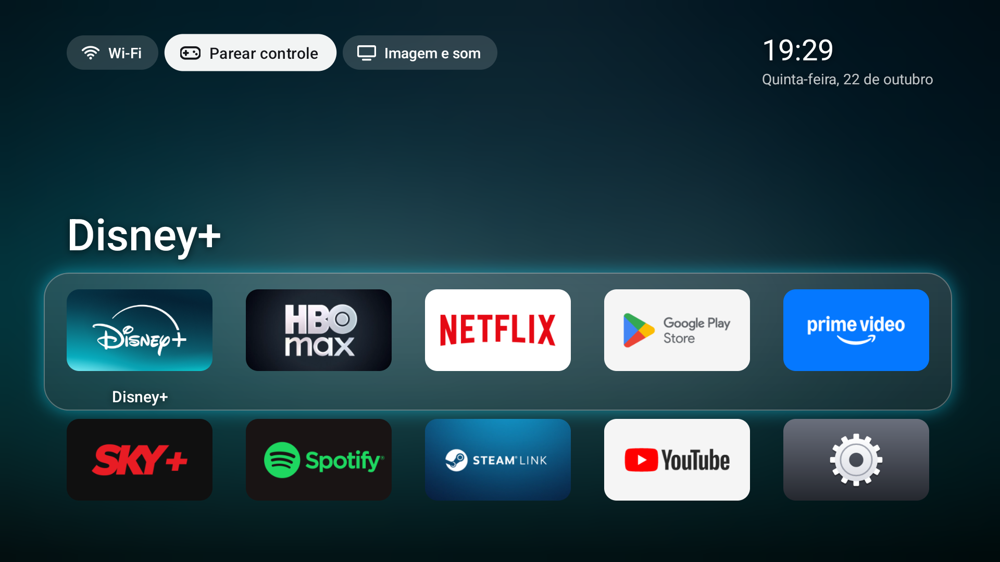

# Projeto TV

Launcher leve no estilo Apple TV e scripts de manutenção para uma **Chromecast com Google TV 4K** (Android 14, 2 GB de RAM).



## O que tem aqui

| Pasta | Conteúdo |
|---|---|
| `tvhome/` | Launcher `dev.tvhome`: Java puro, sem bibliotecas, APK de ~30 KB |
| `tv-setup/` | Debloat aplicado na TV e script para desfazer |
| `docs/` | Capturas de tela |

## Launcher

- Grade de banners com foco ampliado, sombra e reflexo; painel com glow na cor do app em foco.
- Fundo desfocado e com vinheta, derivado do app em foco (escurecido para ícones claros).
- Relógio, data e atalhos: Wi-Fi (com status), Parear controle, Imagem e som, Modo ambiente (transição animada até o protetor de tela).
- Protetor de tela próprio com as suas fotos.
- Reordenar apps: segure OK, mova com as setas, OK para soltar.
- ~22–45 MB de RAM (o launcher do Google usa ~99 MB), frame médio de 11–14 ms.

### Compilar e instalar

Requer JDK 17+, Android SDK (`platforms;android-34`, `build-tools;36.0.0`) e Platform Tools.

```powershell
# uma vez: senha da chave de assinatura (não versionada)
Set-Content tvhome\signing.local "sua-senha" -NoNewline
.\tvhome\build.ps1 -Install -Tv 192.168.0.126:PORTA
```

Na primeira compilação a chave `tvhome.keystore` é criada. **Guarde uma cópia dela e da senha fora do repositório**: sem ela, atualizar o launcher exige desinstalar antes.

Permissões concedidas via ADB após instalar:

```powershell
adb shell appops set dev.tvhome WRITE_SETTINGS allow          # atalho Modo ambiente
adb shell pm grant dev.tvhome android.permission.BLUETOOTH_CONNECT   # atalho Parear controle
```

### Tornar tela inicial (e desfazer)

```powershell
adb shell pm disable-user --user 0 com.google.android.tungsten.setupwraith
adb shell cmd package set-home-activity dev.tvhome/.HomeActivity
adb shell pm disable-user --user 0 com.google.android.apps.tv.launcherx
adb shell pm enable com.google.android.tungsten.setupwraith      # necessário para o Cast (veja abaixo)
```

Para voltar à tela do Google: `tvhome
evert-home.ps1`.

> Desativar o `launcherx` com o `setupwraith` ativo e sem o `dev.tvhome` fixado faz a TV entrar em loop na tela de recuperação do Google (tela preta). Por isso a ordem acima: desativa o `setupwraith`, fixa o `dev.tvhome` (preferido para HOME com `mAlways=true`), desativa o `launcherx` e só então reativa o `setupwraith`. Com isso, ao apertar Home a `RecoveryActivity` abre por um instante, registra `LauncherX HomeActivity not found on device. Skipping enable.` e fecha, caindo no `dev.tvhome`.

> **O `setupwraith` precisa ficar ativo para o Cast e o Google Home.** Ele guarda o `CastInfoProvider`, de onde o Cast (`mediashell`) carrega a credencial do aparelho. Sem ele o log mostra `Cannot get device credentials` / `No private key, hence empty signature`, o celular recusa a conexão e o Google Home mostra a Chromecast como desconectada. Para o Cast recarregar a credencial sem reiniciar a TV:
>
> ```powershell
> adb shell "am force-stop com.google.android.apps.mediashell; am start-foreground-service -n com.google.android.apps.mediashell/.MediaShellCastReceiverService"
> ```
>
> O log deve mostrar `Imported client auth private key`.

> Efeito colateral: as configurações do modo ambiente do Google dependem do `launcherx`; com ele desativado o modo ambiente do Google não é configurável. Por isso o launcher traz o próprio protetor de tela (abaixo); `ambiente-config.ps1 -Start`/`-End` continua disponível para mexer no do Google.

## Protetor de tela com suas fotos

`PhotoDream` mostra as fotos da pasta `fotos/` (fora do Git) em ordem aleatória, com zoom lento, transição suave, relógio e data.

```powershell
.\tvhome\fotos-sync.ps1                          # envia fotos/ para a TV, cortando em 16:9 em volta dos rostos
.\tvhome\fotos-sync.ps1 -Previa                  # só gera a prévia de todos os cortes, sem enviar
adb shell settings put secure screensaver_components dev.tvhome/dev.tvhome.PhotoDream   # uma vez
```

Entra sozinho após o tempo de inatividade da TV ou pelo atalho **Modo ambiente**.

O corte usa o detector de rostos YuNet (OpenCV): as fotos são cortadas em 16:9 mantendo os rostos; as sem rosto, ou estreitas demais, aparecem inteiras sobre um fundo desfocado. Para ajustar uma foto, crie `fotos/cortes.json`, por exemplo `{"foto.jpg": "inteira", "outra.jpg": 0.2}` (0 = corte no topo, 1 = embaixo). Requer uma vez:

```powershell
py -3.13 -m pip install --target "$env:LOCALAPPDATA\tvhome-py" pillow opencv-python-headless
Invoke-WebRequest https://github.com/opencv/opencv_zoo/raw/main/models/face_detection_yunet/face_detection_yunet_2023mar.onnx -OutFile "$env:LOCALAPPDATA\tvhome-py\face_detection_yunet_2023mar.onnx"
```

## Scripts de apoio

| Script | Função |
|---|---|
| `tvhome/tv_remote.py` | Controle remoto pelo Wi-Fi (protocolo Android TV Remote v2), útil sem controle físico |
| `tvhome/bench.ps1` | Mede tempo de abertura, frames e memória na TV |
| `tvhome/rescue.ps1` | Espera a depuração voltar e reativa a tela do Google |
| `tvhome/revert-home.ps1` | Restaura a tela inicial do Google |
| `tvhome/fotos-sync.ps1` | Prepara e envia as fotos de `fotos/` para o protetor de tela |
| `tvhome/ambiente-config.ps1` | `-Start`/`-End`: reativa temporariamente `setupwraith` e `launcherx` para ajustar o modo ambiente e atualizar as fotos da conta (não aperte Home enquanto estiver ativo) |
| `tv-setup/restaurar-tv.ps1` | Reativa os apps desativados no debloat |

## Solução de problemas

- **Google Home mostra a Chromecast desconectada:** confira se o `setupwraith` está ativo (`adb shell pm list packages -d | findstr setupwraith` não deve listar nada) e recarregue o Cast como em [Tornar tela inicial](#tornar-tela-inicial-e-desfazer).
- **`adb connect` recusado ou `failed to connect`:** a depuração por Wi-Fi desligou ou a TV esqueceu o PC. Sem controle físico, use `tvhome/tv_remote.py` (porta 6466, não depende do ADB) e a tecla Configurações para chegar em Sistema > Opções do desenvolvedor > Depuração por Wi-Fi. Ative e, se o `connect` falhar, use "Parear o dispositivo com um código de pareamento": `adb pair IP:PORTA CÓDIGO` e depois `adb connect` na porta mostrada na tela da depuração (`adb mdns services` lista as duas).
- **Sem controle físico:** o controle da TV LG comanda a Chromecast via HDMI-CEC; também servem o controle remoto do app Google Home e o `tvhome/tv_remote.py`. Para parear um controle novo, use o atalho Parear controle.
