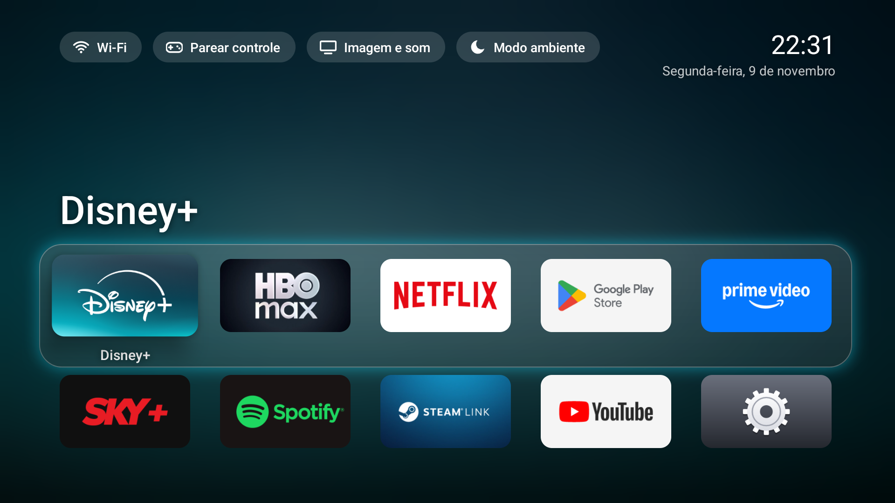

# Projeto TV

Launcher leve no estilo Apple TV e scripts de manutenção para uma **Chromecast com Google TV 4K** (Android 14, 2 GB de RAM).



## O que tem aqui

| Pasta | Conteúdo |
|---|---|
| `tvhome/` | Launcher `dev.tvhome`: Java puro, sem bibliotecas, APK de ~45 KB |
| `tv-setup/` | Debloat aplicado na TV e script para desfazer |
| `docs/` | Capturas de tela |

## Uso de IA

- Desenvolvido com auxílio do [Claude Code](https://claude.com/claude-code).
- O recorte das fotos do protetor de tela usa o detector de rostos [YuNet](https://github.com/opencv/opencv_zoo/tree/main/models/face_detection_yunet) (rede neural do OpenCV) para manter os rostos no enquadramento 16:9.

## Launcher

- Grade de banners com foco ampliado, sombra e reflexo; painel com glow na cor do app em foco.
- Fundo desfocado e com vinheta, derivado do app em foco (escurecido para ícones claros).
- Relógio, data e atalhos: Wi-Fi (com status), Parear controle, Imagem e som, Modo ambiente (transição animada até o protetor de tela).
- Protetor de tela próprio com as suas fotos.
- Segurar OK em um app abre um menu com **Mover** (setas movem, OK solta), **Ocultar** (tira o app da grade), **Informações do app** e, quando há apps ocultos, **Apps ocultos** (escolha um para mostrá-lo de novo).
- Os banners ficam em cache no disco: o launcher abre rápido mesmo depois que o Android o encerra em segundo plano.
- ~22–45 MB de RAM (o launcher do Google usa ~99 MB), frame médio de 11–14 ms.

### Compilar e instalar

Requer JDK 17+, Android SDK (`platforms;android-34`, `build-tools;36.0.0`) e Platform Tools.

```powershell
# uma vez: senha da chave de assinatura (não versionada)
Set-Content tvhome\signing.local "sua-senha" -NoNewline
.\tvhome\build.ps1 -Install
```

O build localiza o JDK por `JAVA_HOME`, depois pelo `javac` do PATH e, por último, pelo JDK mais recente em `C:\Program Files\Java`. Sem `-Tv`, instala na TV à qual o adb está conectado; `-Tv IP:PORTA` é opcional e serve para escolher outra TV.

Na primeira compilação a chave `tvhome.keystore` é criada. **Guarde uma cópia dela e da senha fora do repositório**: sem ela, atualizar o launcher exige desinstalar antes.

Permissões concedidas via ADB após instalar:

```powershell
adb shell appops set dev.tvhome WRITE_SETTINGS allow          # atalho Modo ambiente
adb shell pm grant dev.tvhome android.permission.BLUETOOTH_CONNECT   # atalho Parear controle
```

### Tornar tela inicial (e desfazer)

A tela do Google (`launcherx`) continua sendo a tela inicial oficial e nada do sistema é desativado. O serviço de acessibilidade **Início como tela inicial** (`HomeGuard`) abre o launcher sempre que a tela do Google aparece: ao apertar Home, ao acordar de um standby longo e ao ligar a TV. Ela pode aparecer por uma fração de segundo antes.

```powershell
adb shell settings put secure enabled_accessibility_services dev.tvhome/dev.tvhome.HomeGuard
adb shell settings put secure accessibility_enabled 1
```

Para desfazer: `adb shell settings delete secure enabled_accessibility_services`, ou desative em Configurações > Sistema > Acessibilidade.

> **Não desative o `launcherx`.** O método antigo (desativar o `launcherx` e fixar o `dev.tvhome` como HOME) faz o Android às vezes abrir a `RecoveryActivity` do `setupwraith` como tela inicial; ela se fecha na hora e é reaberta dezenas de vezes por segundo, até o `system_server` cair (`NullPointerException` em `Task.moveTaskToBackInner`). Depois de algumas quedas o Android mostra a tela "Android Recovery" ("Can't load Android system"). Aconteceu em 31/10/2026 e 09/11/2026. Com o `launcherx` ativo, o Android sempre prefere ele para HOME, mesmo com o `dev.tvhome` fixado; por isso o serviço acima. Se a TV ficar em tela preta sem o adb, dá para reativar o `launcherx` pelo `tv_remote.py`: `keys "link:market://details?id=com.google.android.apps.tv.launcherx"`, tocar em **Ativar** e depois `keys HOME`. Com adb: `tvhome\revert-home.ps1`.

> **O `setupwraith` precisa ficar ativo para o Cast e o Google Home.** Ele guarda o `CastInfoProvider`, de onde o Cast (`mediashell`) carrega a credencial do aparelho. Sem ele o log mostra `Cannot get device credentials` / `No private key, hence empty signature`, o celular recusa a conexão e o Google Home mostra a Chromecast como desconectada. Para o Cast recarregar a credencial sem reiniciar a TV:
>
> ```powershell
> adb shell "am force-stop com.google.android.apps.mediashell; am start-service -n com.google.android.apps.mediashell/.MediaShellCastReceiverService"
> ```
>
> O log deve mostrar `Imported client auth private key`.

> Com o `launcherx` ativo, o modo ambiente do Google volta a ser configurável normalmente. O `ambiente-config.ps1` só fazia sentido no método antigo: **não rode o `-End`**, ele desativa o `launcherx` de novo.

## Protetor de tela com suas fotos

`PhotoDream` mostra as fotos da pasta `fotos/` (fora do Git) em ordem aleatória, com zoom lento, transição suave, relógio e data.

```powershell
.\tvhome\fotos-sync.ps1                          # envia fotos/ para a TV, cortando em 16:9 em volta dos rostos
.\tvhome\fotos-sync.ps1 -Previa                  # só gera a prévia de todos os cortes, sem enviar
adb shell settings put secure screensaver_components dev.tvhome/dev.tvhome.PhotoDream   # uma vez
```

Entra sozinho após o tempo de inatividade da TV ou pelo atalho **Modo ambiente**.

O `fotos-sync.ps1` envia as fotos primeiro para uma pasta temporária na TV e só substitui as antigas quando a transferência termina; se ela falhar, as fotos anteriores são mantidas.

O corte usa o detector de rostos YuNet (OpenCV): as fotos são cortadas em 16:9 mantendo os rostos; as sem rosto, ou estreitas demais, aparecem inteiras sobre um fundo desfocado. Para ajustar uma foto, crie `fotos/cortes.json`, por exemplo `{"foto.jpg": "inteira", "outra.jpg": 0.2}` (0 = corte no topo, 1 = embaixo). Requer uma vez:

```powershell
py -3.13 -m pip install --target "$env:LOCALAPPDATA\tvhome-py" pillow opencv-python-headless
Invoke-WebRequest https://github.com/opencv/opencv_zoo/raw/main/models/face_detection_yunet/face_detection_yunet_2023mar.onnx -OutFile "$env:LOCALAPPDATA\tvhome-py\face_detection_yunet_2023mar.onnx"
```

## Scripts de apoio

| Script | Função |
|---|---|
| `tvhome/comum.ps1` | Código comum aos outros scripts: encontra o adb e a TV conectada. O IP usado por `wait-tv.ps1`, `find-tv.ps1` e `tv_remote.py` é 192.168.0.126 por padrão e pode ser trocado pela variável `TVHOME_IP` |
| `tvhome/tv_remote.py` | Controle remoto pelo Wi-Fi (protocolo Android TV Remote v2), útil sem controle físico |
| `tvhome/bench.ps1` | Mede tempo de abertura, frames e memória na TV |
| `tvhome/rescue.ps1` | Espera a depuração voltar e reativa a tela do Google |
| `tvhome/revert-home.ps1` | Restaura a tela inicial do Google |
| `tvhome/fotos-sync.ps1` | Prepara e envia as fotos de `fotos/` para o protetor de tela |
| `tvhome/ambiente-config.ps1` | Só para o método antigo de tela inicial (com o `launcherx` desativado); hoje não é necessário. **Não rode o `-End`**: ele desativa o `launcherx` |
| `tv-setup/restaurar-tv.ps1` | Reativa os apps desativados no debloat |

## Solução de problemas

- **Google Home mostra a Chromecast desconectada:** confira se o `setupwraith` está ativo (`adb shell pm list packages -d | findstr setupwraith` não deve listar nada) e recarregue o Cast como em [Tornar tela inicial](#tornar-tela-inicial-e-desfazer).
- **`adb connect` recusado ou `failed to connect`:** a depuração por Wi-Fi desligou ou a TV esqueceu o PC. Sem controle físico, use `tvhome/tv_remote.py` (porta 6466, não depende do ADB) e a tecla Configurações para chegar em Sistema > Opções do desenvolvedor > Depuração por Wi-Fi. Ative e, se o `connect` falhar, use "Parear o dispositivo com um código de pareamento": `adb pair IP:PORTA CÓDIGO` e depois `adb connect` na porta mostrada na tela da depuração (`adb mdns services` lista as duas).
- **Sem controle físico:** o controle da TV LG comanda a Chromecast via HDMI-CEC; também servem o controle remoto do app Google Home e o `tvhome/tv_remote.py`. Para parear um controle novo, use o atalho Parear controle.
- **`adb devices` travado sem listar nada:** neste PC, um filtro de rede (a proteção web/de rede do Kaspersky ou o driver Npcap) pode quebrar as conexões locais. Pause a proteção do Kaspersky ou adicione uma exceção para o `adb.exe` e tente de novo.
